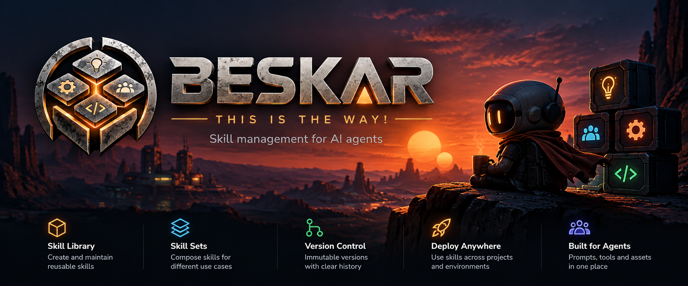

# Beskar

Keep your agent skills in one place and use the right set in each project.

The name is a nod to beskar, the metal used in Mandalorian armor. A little science fiction for your skill toolkit. This is the way.

Beskar is a local command-line tool for maintaining a skill library, grouping skills into profiles, and installing those profiles in workspaces. When you improve a skill, you can update every workspace that uses it. When a workspace has its own edits, Beskar shows the conflict and lets you decide what to keep.

A **skill** is a directory of instructions, scripts, or other files. A **profile** is a named set of skills, such as `coding` or `review`. A **workspace** is any directory you register with Beskar; it does not need to be a Git repository.

Skills are copied into `.agents/skills/` by default. Your agent reads those ordinary files, and the copies keep working even if the library becomes unavailable. Beskar works offline and has no third-party Rust dependencies. It manages local copies and detects changes; it does not provide a version-history store or Git synchronization.

## Install

Download the archive for your platform from [GitHub Releases](https://github.com/ventrion/beskar/releases/latest), unpack it, and put `beskar` (`beskar.exe` on Windows) on your `PATH`.

Releases include Linux, macOS, and Windows builds for x86_64 and ARM64. Linux binaries are statically linked, and `SHA256SUMS` contains the archive checksums. The binaries are unsigned. If macOS blocks a browser download, remove its quarantine attribute with `xattr -d com.apple.quarantine beskar`.

To build from a checkout, use Rust 1.89 or newer:

```sh
git clone https://github.com/ventrion/beskar.git
cd beskar
cargo install --path crates/beskar-cli --offline
```

You can also run `cargo build --release --offline` and use `target/release/beskar` directly.

## Get your first workspace ready

Start with a directory containing skills you already use. In this example, `~/my-skills` contains skill directories named `code-review` and `testing`, each with a `SKILL.md` file. Substitute your own paths and skill names.

```sh
# Create the local library and registry.
beskar init

# Preview the skills Beskar finds, then import them.
beskar library scan ~/my-skills --dry-run
beskar library scan ~/my-skills --yes
beskar library list

# Group imported skills into a profile.
beskar profile create coding code-review testing

# Register a project and install the profile there.
cd ~/projects/my-app
beskar repo add .
beskar repo enable coding
beskar status
```

Your project now has copies at `.agents/skills/code-review/` and `.agents/skills/testing/`. To use a different agent directory, set `beskar config set agent-skills .claude/skills` **before** installing any copies.

Despite the `repo` command name, registering a workspace does not require Git. Commands run from a subdirectory find the nearest registered workspace. Use `--repo PATH` to target a different one. Registered workspaces cannot be nested inside each other.

## Day-to-day use

After editing a skill in the library, preview and apply its updates:

```sh
beskar update --all --dry-run
beskar update --all
```

Leave out `--all` to update only the current workspace. Several enabled profiles install the union of their skills, with one copy of each skill and any required dependencies.

Change a workspace's selection with `beskar repo enable PROFILE`, `beskar repo disable PROFILE`, or `beskar repo toggle PROFILE`. Each command saves the selection and updates the copies immediately. If a conflict blocks the update, the selection stays saved, the copies stay unchanged, and you can finish with `beskar repo update` after resolving the conflict.

If you improve a workspace copy, review it before bringing it back into the library:

```sh
beskar skill diff code-review
beskar skill promote code-review --dry-run
beskar skill promote code-review
beskar update --all
```

Beskar detects local edits and deleted copies. Interactive updates let you inspect a diff, keep the local copy, replace it, or abort. For scripts, choose a [conflict policy](#working-with-local-edits) explicitly. Destinations Beskar does not own are never overwritten or adopted automatically.

## Shell completion

The included [beskar-completions skill](skills/beskar-completions/SKILL.md) helps a coding agent generate and test completion for Bash, Zsh, Fish, PowerShell, Elvish, or Nushell. It ships in both the source tree and release archives.

From a checkout or extracted release, ask your agent:

```text
Read skills/beskar-completions/SKILL.md and set up Beskar completion for my shell.
```

Once installed, completion runs without an agent. It covers commands, options, fixed choices, and paths; live skill and profile names are outside the default setup. Refresh the script after upgrading Beskar.

## Command reference

Every command supports `--help` and `--json`. `beskar help format` describes the file format.

| Area | Commands |
| --- | --- |
| Setup | `init`, `doctor`, `doctor --recover` |
| Configuration | `config show`, `path`, `set KEY VALUE` |
| Library | `library init`, `add PATH`, `scan PATH`, `list`, `show NAME`, `remove NAME`, `require NAME SKILL...`, `unrequire NAME SKILL...` |
| Profiles | `profile create NAME [SKILL...]`, `delete`, `list`, `show`, `add NAME SKILL...`, `remove NAME SKILL...` |
| Workspaces | `repo add [PATH]`, `remove [PATH]`, `list`, `status`, `enable PROFILE...`, `disable PROFILE...`, `toggle PROFILE...`, `update` |
| Registry | `registry list`, `status`, `stats`, `where`, `update --all`, `prune` |
| Local edits | `skill diff NAME`, `skill promote NAME` |
| Shortcuts | `status [--all]`, `update [--all]`, `repo diff`, `repo promote` |

Repository commands use the nearest registered ancestor of the current directory. `--repo PATH` targets another registered workspace. Registered workspaces cannot contain one another; `repo add` rejects nesting before changing the registry. Global updates plan every selected workspace before changing any of them.

`library add` accepts a directory with any contents; `SKILL.md` is optional. Use `--name NAME` when its directory name is unsuitable. `library scan` discovers directories containing `SKILL.md`, stops descending at each skill, and skips `.git` directories while searching. Scan previews a batch before import and requires `--yes` when no terminal is attached. `--dry-run` performs validation without importing.

Names use lowercase letters, digits, hyphens, or underscores. `library show` displays content, a fingerprint, profile membership, requirements, and workspace usage. Beskar refuses to remove a library skill that a profile references or another skill requires, and a profile that a workspace enables. Remove those references first.

```sh
beskar registry list --profile coding
beskar registry where --skill code-review
beskar registry stats
```

`repo remove` unregisters a workspace and preserves its copies. Re-registering makes those existing copies unmanaged. `registry prune` removes only records whose workspace paths no longer exist. Library imports and removals, promotion, updates, and pruning support dry runs.

## Skills that depend on other skills

If a skill needs other skills to work, record its requirements in the library:

```sh
beskar library require code-review git testing
beskar library add ~/new-skill --requires git,testing
beskar library unrequire code-review testing
```

Beskar keeps these records in `library/metadata/NAME.bsk` and never writes into skill directories. Profiles list only the skills you chose. Each update installs those skills plus everything they require, directly or through other requirements. When nothing requires a dependency any more, the next update removes it, and local edits to it still need a conflict decision. `profile add` names the skills that come along. `profile show`, `status`, and `registry where` mark them with `[required by: ...]`. Requirements may form cycles.

## Working with local edits

To tell a library update from a local edit, Beskar compares the last installed version with the current workspace copy and the current library version. Status distinguishes clean copies, library changes, local drift, and divergence. Deleting a tracked copy also counts as local drift.

When an update encounters drift, a terminal user can keep the copy, replace or remove it, inspect a diff, or abort. Replacing requires confirmation. All choices are collected before any files change. Without a terminal, the default stops the whole selected batch.

Scripts choose a policy explicitly:

```sh
beskar update --conflict keep
beskar update --conflict replace
beskar update --conflict abort
```

`--on-conflict` is an alias; `fail` means `abort`. `--conflict ask` requests terminal choices and fails safely when no terminal is available. JSON mode never prompts.

Keeping drift retains its recorded baseline, so future updates still report it. Unmanaged destinations are never overwritten or automatically adopted, even when their contents match the library. Unrelated unmanaged skills remain untouched.

Review and promote a local improvement with:

```sh
beskar skill diff code-review
beskar skill promote code-review --dry-run
beskar skill promote code-review
beskar update --all
```

Promotion updates both the library and that workspace's baseline in one transaction. If the library also changed, it requires `--conflict replace` after review. Promotion is a separate command, so aborting an update cannot leave a promotion partially applied.

## Configuration

State defaults to `~/.beskar`. `--home PATH` overrides `BESKAR_HOME`, which overrides the default.

```text
~/.beskar/
  config.bsk
  registry.bsk
  library/
    skills/
    profiles/
    metadata/
```

Beskar uses versioned `.bsk` records. Paths with spaces or special characters are quoted. There are no inferred types, indentation rules, or environment substitutions.

```text
beskar 1
library "/home/alex/.beskar/library"
registry "/home/alex/.beskar/registry.bsk"
agent-skills ".agents/skills"
```

A profile at `library/profiles/coding.bsk`:

```text
beskar 1
# Review changes before shipping.
skill code-review
skill testing
```

CLI edits preserve config and profile comments, record order, and existing line endings. The registry is generated bookkeeping and is rewritten deterministically. See [FORMAT.md](docs/FORMAT.md) for the complete grammar.

Custom initial locations:

```sh
beskar init --library ~/skill-library --registry ~/.local/state/beskar/registry.bsk
```

Use `config set agent-skills .claude/skills` before installing copies. If installations are already tracked, Beskar refuses to abandon their old destination. Unregister and resolve those copies before switching paths.

`config set library PATH` selects an existing library whose enabled profiles are valid. Prepare the new location before switching. `config set registry PATH` copies the current registry to a new file, or accepts an existing identical registry; its parent directory must exist. It refuses to replace unrelated state. Both changes are journaled. Alternatively, edit config while Beskar is idle.

## Automation and coding agents

`--json` emits exactly one result document on standard output:

```json
{"ok": true, "data": {}, "error": null}
```

`data` contains the command's structured result. Update reports include repository paths, skill states, proposed actions, fingerprints, profile membership, and the skills that require each dependency. Failed updates retain their conflict reports. Errors include a `kind` and `message`; human-readable diagnostics also go to standard error.

Exit codes are 0 for success, 1 for an operation failure or unresolved conflict, and 2 for invalid command syntax. Dry runs fail when the corresponding update would be blocked. Piping output into a program that closes early does not panic.

## Recovery and concurrency

Updates, imports, promotion, registry changes, and configuration changes stage replacements and keep originals in backups. One journal covers every selected workspace and the registry. Ordinary filesystem failures roll back partial work.

After an interrupted operation, run:

```sh
beskar doctor --recover
```

Recovery removes temporary copies from interrupted staging, restores originals from a partial apply, or finishes cleanup when all new targets are already in place. Before recovering an apply, it checks fingerprints. If a target or backup was edited after interruption, both are preserved for manual recovery; the journal records their locations. New empty deployment directories are removed during rollback, while directories containing unrelated files survive.

Kernel locks coordinate the home, library, registry, and each registered repository, including across different Beskar homes. Locks release when the process exits or is killed. Their empty files remain: `.lock` in the home, `.beskar.lock` in library and repository roots, and `<registry-file>.lock`. Do not delete these files while Beskar runs. Exclude them from Git when applicable.

Skills contain regular files and directories. Beskar fingerprints all their contents, including `.git` and caches, and rejects symlinks and special files. Symlinks in the directories that contain the home, library, registry, a workspace, or an import source, such as `/var` on macOS, are resolved once and Beskar records the resolved path. Paths must be UTF-8. File ownership, extended attributes, and directory permissions are not replicated. Directory entries are synced on Unix; rename durability on other systems depends on their filesystem. The test suite runs on Linux, macOS, and Windows.

## Contributing

The workspace has three crates: `bsk` parses the record format, `beskar-core` owns domain operations and filesystem transactions, and `beskar-cli` handles commands, prompts, and output. Start with the [architecture guide](docs/ARCHITECTURE.md) to understand how plans, conflict decisions, and recovery fit together.

Run the same checks used by CI:

```sh
cargo test --workspace --offline
cargo build --workspace --release --offline
cargo clippy --workspace --all-targets --offline -- -D warnings
cargo fmt --all --check
RUSTDOCFLAGS="-D warnings" cargo doc --workspace --no-deps --offline
```

For people and coding agents working on the source:

- [AGENTS.md](AGENTS.md) is the entry point for repository instructions.
- [CONTEXT-MAP.md](CONTEXT-MAP.md) links to each crate's domain vocabulary and responsibilities.
- [Issue tracker guide](docs/agents/issue-tracker.md) explains the git-native Rohrpost tracker under `.rohrpost/`; use the `rp` CLI with `--json`.
- [Triage labels](docs/agents/triage-labels.md) describes how issues become ready for human or agent work.
- [File format](docs/FORMAT.md) specifies `.bsk` records.
- [Design decisions](docs/adr/) and the [consolidation review](docs/CONSOLIDATION.md) explain the choices behind the implementation.

The [original brief](docs/BRIEF.md) includes broader ideas. Classification, Git synchronization, and a TUI remain outside the current implementation.

### Releases

Set `version` in the root `Cargo.toml`, merge the change, then tag that commit `v<version>` and push the tag. The [release workflow](.github/workflows/release.yml) checks that the tag matches the version, tests natively on Linux, macOS, and Windows, and publishes all six archives with `SHA256SUMS`. Pull requests that change the workflow build the archives without publishing.

## License

Beskar is licensed under the [MIT License](LICENSE).
